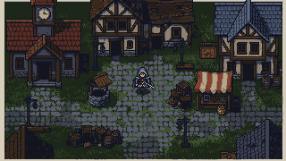

# Last Ink: Art Style Bible

Every art pass asset is made and judged against this page. It exists because assets generated one by one, each
looking fine on its own, did not fit together (Phase 3 review, 2026-11-19). The fix: one approved target scene,
one fixed palette, and generation that is always anchored to them.

## The target scene

`docs/style/target_plaza.png` (320 x 180, one game screen at 1:1) was approved by Ojon on 2026-11-19. It is the
reference for the whole game: when an asset and the target disagree, the target wins. Crops of it are the
generation references in `docs/style/` (`ref_building.png`, `ref_props.png`, `ref_grass.png`, `ref_cobble.png`).

## Rules

| Rule | Value |
|---|---|
| **Camera** | Top-down three-quarter, like SNES action RPGs. Buildings and props face the camera **straight on**: front wall parallel to the screen, roof seen from above, no side walls, never isometric or diagonal. Characters use PixelLab's `high top-down` (Ash is the reference). |
| **Scale** | 16 px tiles. Heroes, NPCs and small enemies on a 32 px canvas (about 2 tiles tall). A 5x5-tile building plot holds an 80 x 80 sprite. |
| **Light** | From the top left. Shadows fall to the bottom right. |
| **Outline** | Ink black `#12141f` outer outline on characters, enemies and objects; inner edges use the darkest shade of the local colour. Ground tiles have no outline. |
| **Shading** | Cel shading, 3 to 4 shades per material, no dithering on objects, no anti-aliasing, hard alpha. |
| **Palette** | The 38 colours of `tools/style_palette.hex` and nothing else (below). |
| **Mood** | Muted and a little gloomy: charcoal, bone, rust, moss, slate. Saturated colour is saved for accents, light (candles, lamps, Ink glow) and character signatures. |

## Palette

`tools/style_palette.hex`, in ramps: ink and night slate, stone (4), wood (5), plaster and bone (4), foliage (6),
slate roof (3), clay roof (3), skin (3), then the accents (Ash ink-blue, Ink glow, Bran rust, Daro brass,
lamplight, Gristle poison green, crimson). **Paper white `#f3eee2` is not in it**: only the Blank uses it, and the
Blank's erasure of the world is a code effect drawn over the art, so no "erased" versions are generated.

## Materials

The town and the countryside are built from one small vocabulary, so different buildings read as one place:
- Walls: dark timber frame with bone plaster, or warm grey stone, or plain planks for poor buildings.
- Roofs: slate blue or dark red clay. Nothing else.
- Ground: dark mossy grass, mossy grey cobbles in towns, packed brown dirt paths in the country.
- Metal: dark iron (stone dark and ink shades), brass only as an accent.

## How assets are generated

1. **Buildings and props:** PixelLab `POST /v2/generate-image-v2` (Pro, about $0.08 per call, several options per
   call) with a crop of the target as `style_image`, `style_options.color_palette = false`, and
   `target_palette` = the 38 colours. Prompts start with the camera sentence:
   *"Front view pixel art building sprite for a top-down RPG, flat front facade facing the viewer straight on, roof
   seen from slightly above, no side walls, no isometric angle: ..."* (props: *"Single pixel art game prop sprite
   for a top-down RPG, seen from slightly above and straight on from the front: ..."*).
2. **Building levels:** level 3 first; levels 1 and 2 use the chosen level 3 as a `reference_image` and ask for a
   humbler version, so material and roof stay the same.
3. **Ground:** `create-tileset` with the target's grass and cobble crops as lower and upper references and the
   palette as `color_image`; then snapped.
4. **Characters:** `create-character-v3` as before (Ash's settings), then snapped to the palette on import.
5. **Every asset** goes through `tools/palette_lock.py` `snap()` before it enters the game (hard alpha, Ink
   outline, 38 colours).

## How assets are picked

- Judge candidates **in place**: on the game ground at game zoom, next to Ash and the target's neighbours, never on
  their own on a plain background.
- Pick for fit with the set, not for the most impressive single image.
- Reject anything off-angle (diagonal, isometric, a ground patch under it), off-scale or off-palette.
- Each phase PR shows an in-game screenshot beside the target.

## Sitting in the world

Generated sprites come out front-on and evenly lit, so on their own they look pasted onto the ground. Code
and one offline pass make them belong:

- **Depth pass** (`tools/depth_pass.py`): eave shadow under every roof, contact shade along the base,
  right-side shade (light from the top left). Palette steps only: each darkening is one step down the
  material's own ramp. Originals stay in `tools/art_src/`, so rerunning never darkens twice.
- **Variants** (same tool): roof recolours (stone to clay or blue slate), moss on roofs, wood and plaster
  shifted a step, written as `<kind>_v1.png`, `_v2`... `scripts/prop.gd` picks one per placement from its
  map position, so a row of houses never shows the same sprite twice in a row. No flips: they would break
  the top-left light.
- **Cast shadows** (`Art.add_cast_shadow`): each prop and building throws its own silhouette to the right
  along the ground, minus itself. The shadow is a sibling in the Y-sorted entities, sorted a little in front
  of its caster, so it falls over a neighbour's wall or a barrel beside a stall.
- **Lamps** (`Art.add_lamp`): two lights each. A shadowed one lights only the ground (light mask 2), so prop
  footprints (`Art.add_occluder`) throw shadows on it; an unshadowed one lights actors and props (mask 1),
  so nothing stands in its own shadow.
- **Scene effects** (`scripts/ambience.gd`): drifting cloud shadows by day, low mist that thickens at dawn,
  dusk and night, and a vignette. Every effect has a slider in Options > Visual effects (`Settings.FX`).
- Real 3/4 depth (roofs seen from above) can only come from regenerating the sprites; see docs/ART_SPEND.md.
